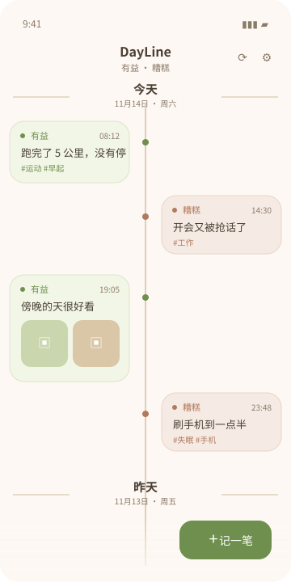

<div align="center">

# DayLine · 暖记

**一条中轴，两栏人生。**

左边记「让我变好的事」，右边记「让我难受的事」。
按天分组、倒序排列、往上无限翻。

[](#)
[](#)
[](#)
[](#)
[](LICENSE)
[](#测试)



</div>

---

## 这是什么

大多数记录类 App 把你往"效率"和"打卡"上推：连续天数、成就徽章、绿色对勾。
DayLine 反着来——它默认你**今天会记一些不好的事**，并且给你一个专门的位置放它们。

一条竖着的中轴把屏幕劈成两半：

```
┌─────────────────┬──┬─────────────────┐
│  🟢 有益         │  │                 │
│  跑完了 5 公里   │  │                 │
│  ── 08:12       │  │                 │
├─────────────────┼──┼─────────────────┤
│                 │  │  🔴 糟糕         │
│                 │  │  开会又被抢话    │
│                 │  │  ── 14:30       │
├─────────────────┼──┼─────────────────┤
│      ────  今天 · 11月14日 · 周六  ──── │
├─────────────────┼──┼─────────────────┤
│                 │  │  🔴 糟糕         │
│                 │  │  失眠到三点      │
└─────────────────┴──┴─────────────────┘
```

三个不可让步的设计约束，决定了这个 App 的全部形态：

| 约束 | 为什么 | 落地位置 |
|---|---|---|
| 左右分栏共用**一条连续中轴** | 轴断了，「一天」这条时间线就断了，产品隐喻失效 | `TimelineRow.kt`：`Row(左侧 weight(1f) │ 中轴 44dp │ 右侧 weight(1f))` |
| 日期分组是**真实列表项**，不是 `stickyHeader` | 吸顶浮层会盖住中轴，且不参与 Paging 的 itemCount，翻页边界会丢组头 | `DayHeader.kt` + 按天分页 |
| 数据库只存**相对路径**，不存字节流 | 几百个视频塞进 SQLite 会让 DB 涨到 GB 级、VACUUM 卡死 | `RecordEntity.imagePaths: List<String>` |

## 功能

- **双栏时间轴**：左侧有益 / 右侧糟糕，一天内按时间正序，跨天倒序，无限往上翻
- **日期吸顶**：今天 / 昨天 / 前天 / `11月11日`，跨年自动补年份
- **富媒体**：最多 9 张图片 + 3 个视频，视频入列表只占封面帧不自动播放
- **标签**：多标签复用，同名标签跨记录共享
- **回收站**：软删除 + 可撤销 + 可配置保留期（7 / 30 / 90 天 / 永不）
- **备份**：导出 `records_yyyy-MM-dd.zip`（含媒体），换机或与朋友合并；导入按 id 合并、按内容指纹去重
- **深色模式**：重新设计的深咖底 + 低饱和暖色，不是简单反色
- **完全离线**：没有账号、没有网络请求、没有云同步，你的日记只在你手机里

## 技术栈

| 层 | 选型 | 版本 |
|---|---|---|
| 语言 | Kotlin | 2.0.21 |
| UI | Jetpack Compose + Material 3 | BOM 2024.12.01 |
| 本地库 | Room（KSP） | 2.6.1 |
| 分页 | Paging 3 | 3.3.4 |
| 配置 | DataStore Preferences | 1.1.1 |
| 图片 | Coil | 2.7.0 |
| 序列化 | kotlinx.serialization | 1.7.3 |
| 构建 | AGP 8.7.3 / Gradle 8.11.1 / JDK 17 | |
| 最低系统 | Android 8.0 · API 26（原生 `java.time`） | |

**有意不引入的依赖**：

- **Hilt / Koin** —— 依赖图只有 8 个对象一条链。手写 `AppContainer`，迁移点已预留。
- **navigation-compose** —— 只有 4 个目的地，`sealed interface Screen` + `BackHandler` 行为更可预测。
- **Zip4j** —— `java.util.zip` 够用，且能在 JVM 单测里跑真 zip 往返。

## 架构

```
        ┌─────────────────────────────────────────┐
        │  ui/   Compose                     │
        │  timeline · editor · trash · settings  │
        └──────────────────┬──────────────────────┘
                           │ StateFlow / PagingData
        ┌──────────────────▼──────────────────────┐
        │  DaylineViewModel（单 VM，按 Repository 拆） │
        └──────────────────┬──────────────────────┘
                           │
        ┌──────────────────▼──────────────────────┐
        │  data/repo   RecordRepository            │
        │              TimelinePagingSource        │
        │              MergeApplier                │
        └───────┬──────────────────┬───────────────┘
                │                  │
      ┌─────────▼──────┐   ┌───────▼────────┐
      │  Room (db/)    │   │  MediaStore    │
      │  4 tables      │   │  sha256 寻址    │
      └────────────────┘   └────────────────┘
```

`backup/` 是**纯逻辑层**（除 `BackupServices` 需要 `Context`），所以 `MergeEngine`、`Fingerprint`、`Naming`、`ZipArchive` 全部能在 JVM 单测里跑，不需要 Robolectric。

<details>
<summary><b>数据表结构</b></summary>

| 表 | 关键列 | 说明 |
|---|---|---|
| `records` | `id` TEXT PK · `recordDate` TEXT · `side` · `isDeleted` · `contentFingerprint` | UUID 主键，多设备合并不撞车 |
| `tags` | `id` PK · `name` UNIQUE | |
| `record_tag` | `(recordId, tagId)` 复合主键 | 双向 CASCADE |
| `media_files` | `sha256` PK · `relativePath` UNIQUE | 内容寻址索引 |

**为什么 `recordDate` 是 `yyyy-MM-dd` 字符串而不是毫秒时间戳**：用户关心的「哪一天」是本地日历日。用时间戳跨时区/夏令时会把同一天切成两天，日期组头随之重复。字符串字典序 = 时间序，`DISTINCT + ORDER BY DESC` 直接可用。

</details>

## 三个最容易被"顺手优化"掉的决策

### 1. 按「天」分页，不按「记录」分页

按记录分页时，跨页边界的两条记录可能同属一天，两页各自插一个「11月14日」的头，滚动时就看到重复日期。

```kotlin
// TimelinePagingSource：一个 LoadResult.Page 的边界永远落在"天"与"天"之间
val dates = dao.pageDates(limit = 7, offset = page * 7)
for (date in dates) {
    items += TimelineItem.DayHeader(date)
    byDate[date]?.forEach { items += TimelineItem.Entry(it) }
}
```

`TimelinePagingSourceTest.连续翻页时日期头不重复也不丢` 就是守这条的——谁改回去，测试立刻红。

### 2. 预加载必须有两条路径

```kotlin
PagingConfig(prefetchDistance = 14, enablePlaceholders = false)   // 路径 1：数据层
```

```kotlin
// 路径 2：UI 侧触底提前量（600dp）
LaunchedEffect(items, shouldLoadMore) {
    if (!shouldLoadMore) return@LaunchedEffect
    if (items.itemCount > 0) items[items.itemCount - 1]   // ← 真正的触发
}
```

**坑**：`items.loadState.append = LoadState.Loading` 这种写法不会触发加载——`loadState` 是状态快照，赋值只改了本地数据。真正的触发是**访问一个尚未加载的位置**。路径 1 管慢速滚动，路径 2 管"一把甩到底"。

### 3. 已删除记录只按 id 合并，不参与内容去重

否则会出现：「我在 A 机删了这条」+「B 机还有同内容的未删除副本」→ 被当成重复跳过 → 删除状态丢失，或者反过来把用户的删除"复活"。

## 测试

```bash
./gradlew :app:testDebugUnitTest
```

| 测试类 | 用例 | 覆盖 |
|---|---|---|
| `MergeEngineTest` | 12 | 插入 / 更新 / 跳过旧 / 时间相同 / 内容重复 / 批次内重复 / 已删除只按 id / 标签顺序无关 / 空白归一 / 侧别·日期不同 |
| `TimelinePagingSourceTest` | 8 | 一页 7 天出 7 头 / 同日多条只一头 / **跨页头不重不丢** / prevKey·nextKey / 末页 / 已删除不进轴 / 空库 |
| `ZipArchiveTest` | 8 | 往返 / STORED 判据 / 父目录穿越 / 反斜杠穿越 / 盘符 / 控制字符 / `resolveInside` |
| `NamingTest` | 6 | 无后缀 / 序号追加 / 99 次后时间戳 / 扩展名 / 媒体类别 / 正斜杠 |
| **合计** | **34** | **0 failures** |

全部纯 JVM，单次全跑 < 1 秒，不需要设备或 Robolectric。

## 构建

环境：**JDK 17** + **Android SDK 35**。

```bash
git clone <this-repo> && cd dayline

./gradlew :app:assembleDebug      # APK → app/build/outputs/apk/debug/app-debug.apk
./gradlew :app:testDebugUnitTest  # 34 个单测
./gradlew :app:lintDebug          # 当前 0 issues
```

`local.properties` 里的 `sdk.dir` 指向本机 Android SDK，已被 gitignore。

<details>
<summary><b>常见构建问题</b></summary>

| 现象 | 原因 | 处理 |
|---|---|---|
| `error: resource mipmap/ic_launcher not found` | 把自适应图标从 `res/mipmap-anydpi-v26/` 挪到了 `mipmap-anydpi/` | 必须保留 `-v26`，`<adaptive-icon>` 只认这个目录 |
| `generateDebugAndroidTestLintModel FAILED` | 工程还没有 `androidTest` 源集 | `-x generateDebugAndroidTestLintModel -x lintAnalyzeDebugAndroidTest` |
| 依赖下载卡住 | 首次需要拉 AGP / Kotlin / Compose 全套 | 配好代理或镜像；缓存建立后可 `--offline` |

</details>

## 代码地图

```
app/src/main/java/com/dayline/
├─ DaylineApp.kt              手写 AppContainer
├─ MainActivity.kt            单 Activity + sealed Screen 路由
├─ data/
│  ├─ db/                     4 张表 · 3 个 DAO · TypeConverter
│  ├─ repo/
│  │  ├─ TimelinePagingSource.kt   ★ 按天分页
│  │  ├─ RecordRepository.kt       保存（哈希在事务外）
│  │  └─ MergeApplier.kt           导入落库
│  ├─ media/MediaStore.kt     sha256 内容寻址 · 首帧封面
│  └─ prefs/SettingsRepository.kt
├─ backup/
│  ├─ MergeEngine.kt          纯函数合并决策
│  ├─ Fingerprint.kt          内容指纹
│  ├─ ZipArchive.kt           双层 zip-slip 防护
│  └─ BackupServices.kt       导出 / 导入
├─ ui/
│  ├─ timeline/               TimelineScreen · TimelineRow · DayHeader
│  ├─ editor/ · trash/ · settings/
│  ├─ components/MediaThumb.kt
│  └─ theme/                  暖色系（浅色 + 深色）
└─ util/Dates.kt              今天 / 昨天 / 前天 / 具体日期
```

## 路线图

- [x] 双栏中轴时间轴 + 按天分页
- [x] 媒体内容寻址 + 视频封面
- [x] 导出 / 导入 zip + 合并去重 + zip-slip 防护
- [x] 回收站 + 可配置保留期
- [x] 深色模式
- [ ] DAO / Compose instrumentation 测试
- [ ] 标签筛选与全文搜索
- [ ] 每日提醒（WorkManager）
- [ ] 周 / 月回顾视图

## 已知限制

1. **`OFFSET` 分页**：单用户超过约 5000 天记录会线性扫描变慢，届时改 keyset（`WHERE recordDate < :lastDate`）。
2. **无 instrumentation 测试**：DAO 行为与 Compose UI 未覆盖。
3. **仅 debug 包**：尚未配置 `signingConfig`，发版需补。

## 贡献

欢迎 issue 和 PR。提交前请确保：

```bash
./gradlew :app:testDebugUnitTest :app:lintDebug
```

两者都通过。新功能请附带能跑的单测——尤其是碰到分页、合并、zip 这三块时，它们是这个项目最容易悄悄写错的地方。

## 许可

本项目采用 **[Apache License 2.0](LICENSE)** 授权。

```
Copyright 2026 The DayLine Authors

Licensed under the Apache License, Version 2.0 (the "License");
you may not use this file except in compliance with the License.
You may obtain a copy of the License at

    http://www.apache.org/licenses/LICENSE-2.0
```

第三方依赖及其许可见 [NOTICE](NOTICE)。本仓库**不内置**任何第三方源代码，依赖通过 Gradle 从 Maven 仓库解析并各自保留原始许可。

---

<div align="center">

记录不是为了变好，是为了**看见**。
看见那些悄悄让你变好的事，也看见那些悄悄耗着你的事。

</div>
